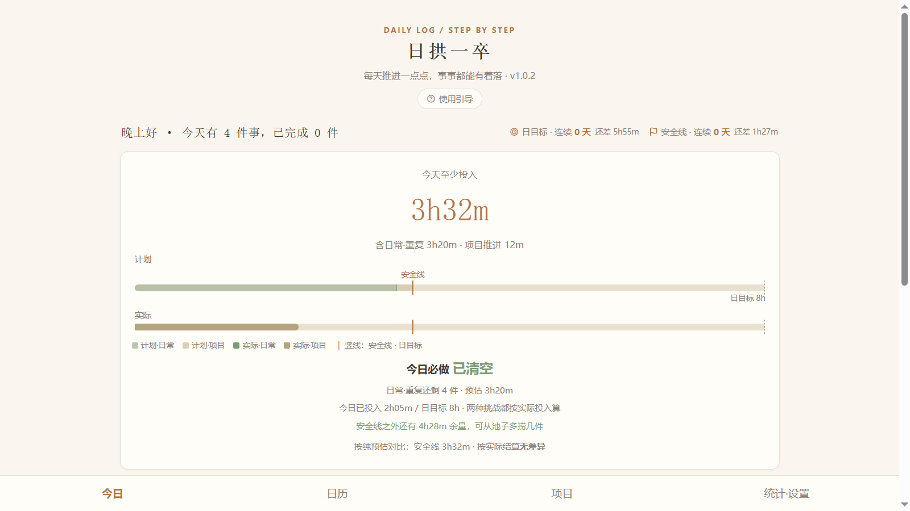
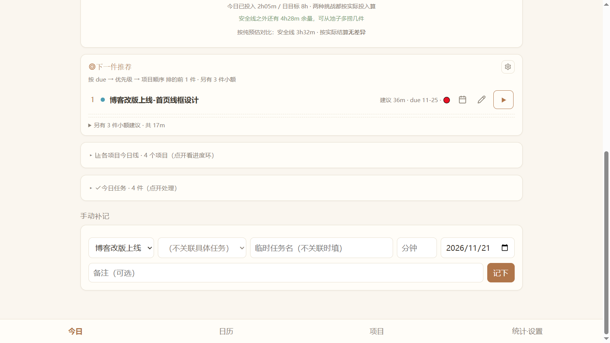
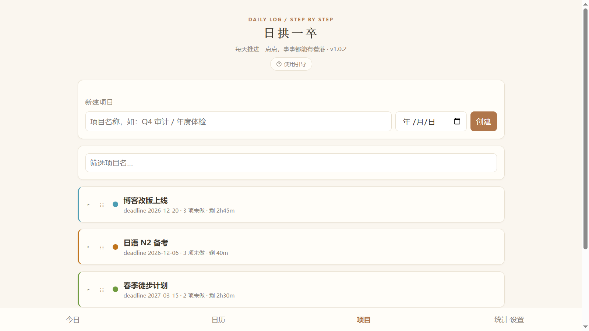
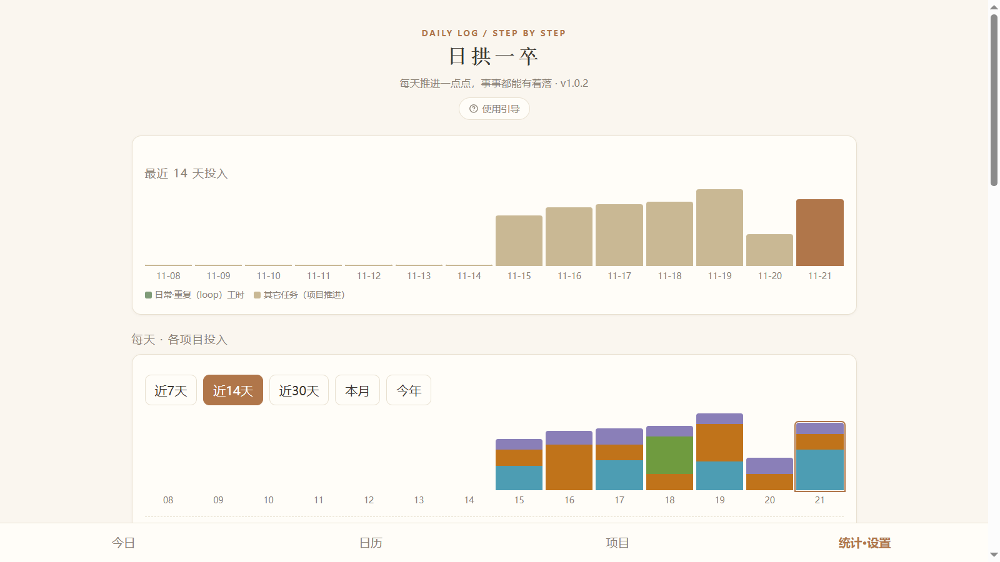
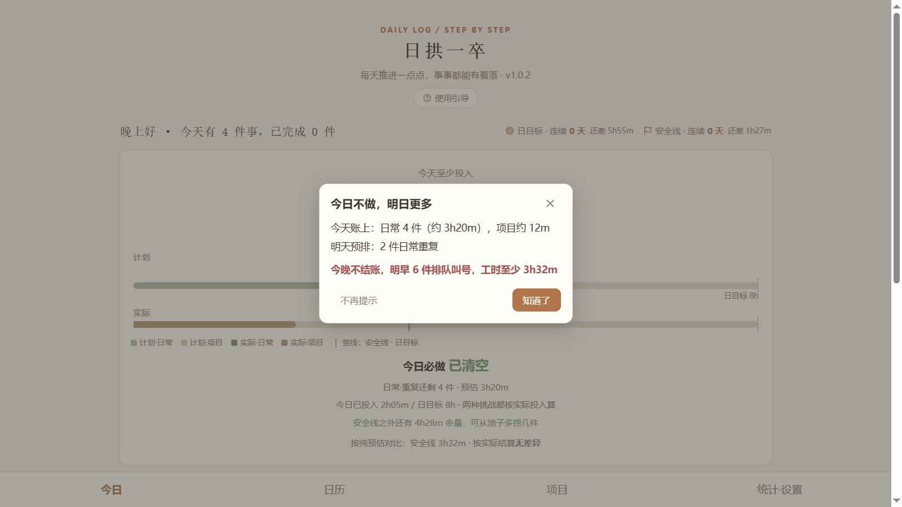
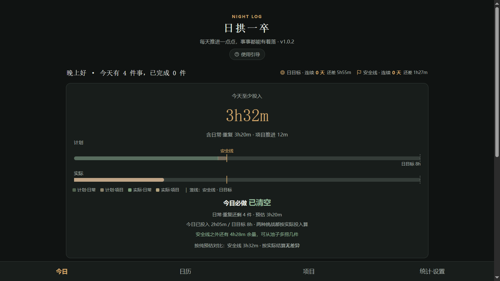
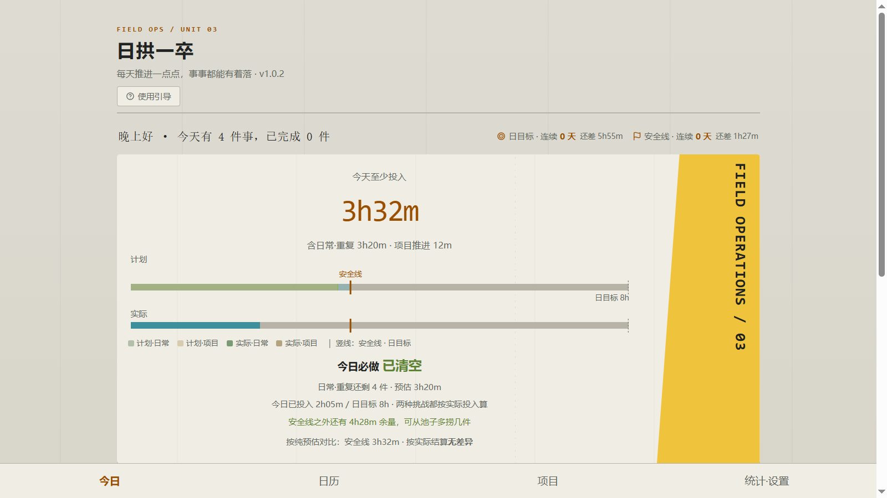
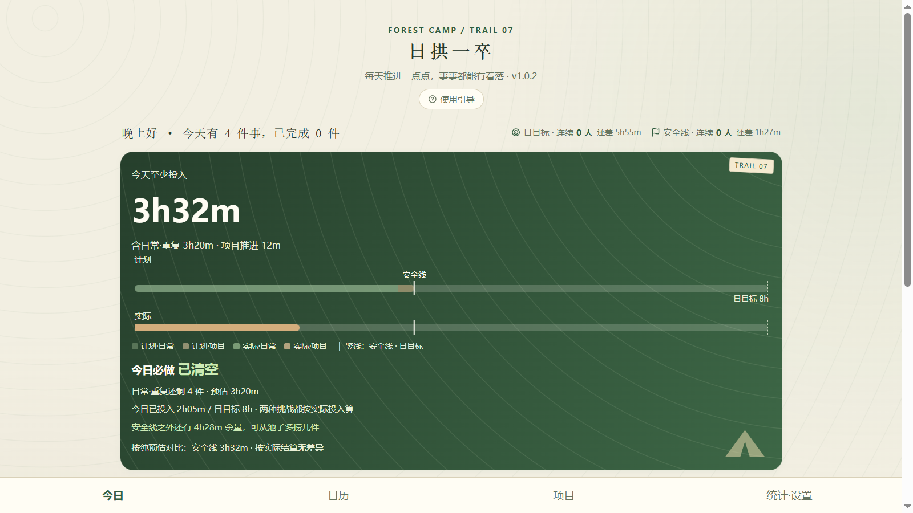
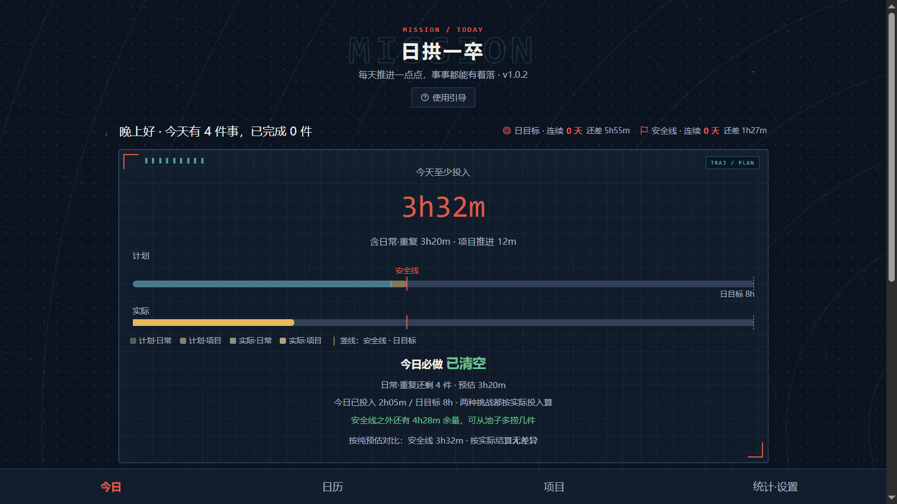

<p align="center">
  
</p>

<h1 align="center">日拱一卒 daily-pace</h1>

<p align="center">每天推进一点点，事事都能有着落。</p>

一个**纯本地、单文件、零依赖**的 deadline 配速器 + 工时记录工具。
Python 标准库后端 + 原生 JS 前端，不用装任何 pip 包，不用构建，克隆下来就能跑。

它的核心不是「列待办」，而是回答一个问题：**按现在的进度，今天该干多久才不会在截止日前翻车？**

## 核心机制

- **安全线（Safety Line）**：按项目剩余工时 ÷ 剩余工作日，算出每个项目今天至少要投多少分钟；所有项目加总就是今日安全线。每天都在动态重算——今天多干了，明天的线就降。
- **动态结算**：勾掉的日常任务按**实际工时**降安全线（干得比预估快，线真的降；超时只给角标不扩线）。也可以关掉回到纯预估口径。
- **日常 / 周期重复**：
  - 日常（每天 / 每个工作日）自动出现，当天实例预估计入安全线，勾掉自动长出下一件；跳勾没做的日常会自动顺延到最近适用日，不会从今日排期里失踪。
  - 周期重复（每周几 / 每 N 周的周几 / 每月几号 / 每月第 N 个周几 / 每月第 N 个工作日，可跳法定节假日）勾掉生成下一期实例，计入安全线。
  - 「提前几天开始」的窗口期：窗口一开，这期实例的预估就计入安全线，今日页提前亮出，日历铺虚影。
- **双连续挑战**：日目标连续达标 + 安全线连续达标两条独立计数，安全线为 0 的日子不中断也不累计。
- **正计时 / 手动补记**：任务一键开始计时，或事后按分钟补记（补记可直接写新任务名）。「下一件推荐」可直接完成，「今日已投入」旁有补记入口。
- **日历视图**：真实排期 + 重复任务投影虚影，支持拖拽从任务池排到具体日期；单击只看详情，取消排期使用明确按钮。
- **统计**：每天各项目投入、逐 loop 耗时、预估自动校准建议、按标签算均次耗时；跨天完成的实例会合并计算整个实例的工时。
- **五套界面皮肤**：经典 · 纸面 / 夜间 · 夜间档案 / 机能 · FIELD OPS / 自然 · 森林露营 / NASA 朋克 · 轨道计划，下拉即换，按设备记忆。
- **局域网访问**：电脑开着服务，手机连同一 Wi-Fi 就能用（可一键关闭只绑本机）。页头「手机访问」按钮弹出二维码，手机扫码直接打开。
- **手机跳转页（PWA）**：GitHub Pages 托管的跳转页（`docs/go.html`）能记住多台 pace 的地址（如家里 / 公司），打开后自动探测能通的那台，3 秒倒计时进入（可取消）。页头是 https 地址，可安装为桌面 app。默认地址下载即用，自托管地址可在系统设置中修改并持久保存。
- **局域网同步**：两台电脑在设置页互填对端地址，一键拉取 / 推送整库；方向错了会拦，覆盖前自动备份。适合「白天公司、晚上家里」接力使用。
- **自动更新**：设置页一键检查更新，更新源可以是 GitHub Pages，也可以是局域网里另一台跑着新版的 pace。逐文件 sha256 校验，替换前自动备份旧文件。
- **数据完全本地**：一个 SQLite 文件（`data/pace.db`），每天自动备份到 `data/backup/`，可在页面内恢复备份，也可导出筛选后的 Excel / JSON。

## 界面预览

> 截图中的项目与工时均为虚构演示数据。

| 今日页（安全线 hero） | 下一件推荐 + 手动补记 |
| --- | --- |
|  |  |

| 日历（重复任务虚影投影） | 项目列表 |
| --- | --- |
|  |  |

| 统计页 | 每日鞭策 |
| --- | --- |
|  |  |

五套皮肤随下拉即换：

| 夜间 · 夜间档案 | 机能 · FIELD OPS |
| --- | --- |
|  |  |

| 自然 · 森林露营 | NASA 朋克 · 轨道计划 |
| --- | --- |
|  |  |

## 快速开始

需要 Python 3.10+（只用标准库）。

```bash
python app.py
```

打开浏览器访问 <http://127.0.0.1:18630>，完。

Windows 用户也可以直接双击：

- `启动.bat` — 启动服务并打开浏览器
- `停止.bat` — 停止服务
- `生成快捷方式.bat` — 生成桌面快捷方式（移动文件夹后重跑一次）

命令行参数：

```bash
python app.py --port 8080        # 换端口
python app.py --host 127.0.0.1   # 只绑本机（关闭局域网访问）
python app.py --no-open          # 不自动打开浏览器
```

## 数据与隐私

- 所有数据都在 `./data/` 目录下，不联网、不上传、没有任何遥测。
- 换电脑：整个文件夹拷走即可，数据跟着走。
- 删除数据：删掉 `data/` 目录就是全新开始。

## 项目结构

```
daily-pace/
├── app.py            # 后端：HTTP 服务 + 业务逻辑 + SQLite，单文件
├── static/
│   ├── index.html    # 页面骨架
│   ├── app.js        # 前端全部逻辑
│   └── style.css     # 样式 + 五套皮肤
├── docs/             # GitHub Pages：手机跳转页 + 自动更新发布目录 + README 截图
├── tools/            # make_release.py 等发布工具
├── 启动.bat / 停止.bat / 生成快捷方式.bat
└── 更新日志.txt       # 逐版本更新记录
```

## 设计哲学

这不是又一个 todo list。它假设你**知道自己有哪些事、但总是低估需要的投入**，
所以把「截止日期」翻译成「今天该干多久」，并且在你偷懒时（动态结算、顺延提醒、
每日鞭策）把账算给你看。文案语气可能有点凶，是故意的。

## 致谢

由 [kinokitano](https://github.com/C3H18O2) 提出需求与设计，与 [Kimi Code](https://www.kimi.com/)（月之暗面）结对编程完成全部实现。

## License

[PolyForm Noncommercial 1.0.0](LICENSE)（源代码可见，非 OSI 定义的开源）

个人学习、研究、业余项目、公益/教育/政府机构等非商用场景自由使用、修改、分发；
**商业用途需另行取得书面授权**。2026-11-25 换证前曾按 MIT 发布过数日，期间获取的
副本对获取者仍按 MIT 生效。
